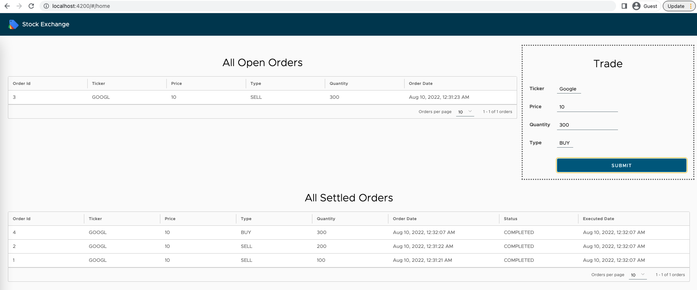
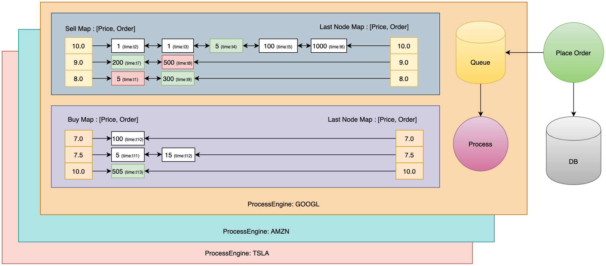
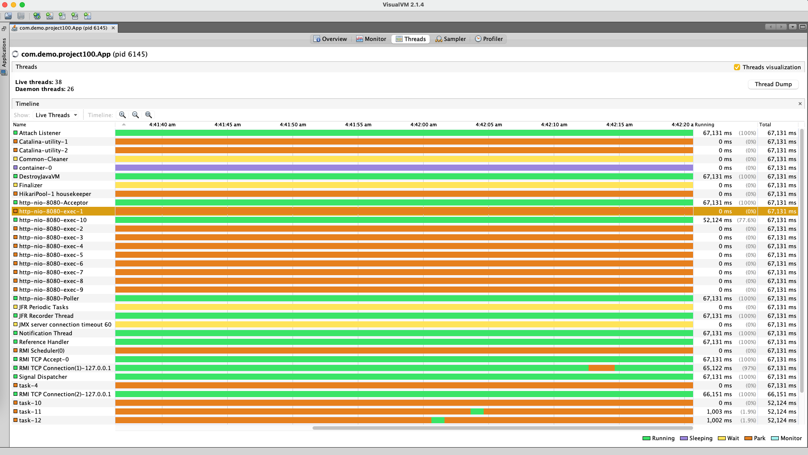
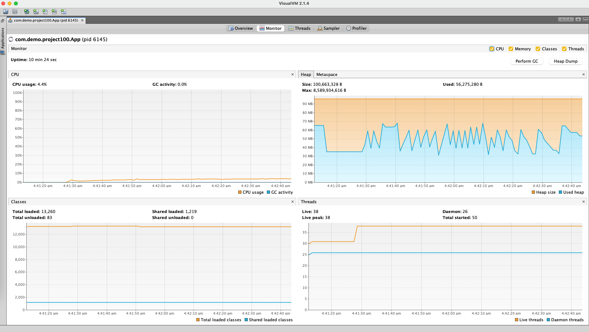

A Stock Exchange system developed with Spring Boot, Spring JPA and Angular (Clarity) frontend. Implements the price-time-priority algorithm

Github: [https://github.com/gitorko/project100](https://github.com/gitorko/project100)

## Quick Overview

To deploy the application, clone the project, make sure no conflicting docker containers or ports are running, build the application and UI, then start Docker Compose:

```bash
git clone https://github.com/gitorko/project100
cd project100
./gradlew cleanBuild
docker compose -f docker/docker-compose.yml up --build
```

Open [http://localhost:8080/](http://localhost:8080/)

## Requirements

Design a stock exchange system for various tickers, user can place buy and sell orders.

### Functional Requirements

1. Buy & Sell orders must be processed based on priority of time when they were placed.
2. Priority must be given to clear order placed first. FIFO (First-In-First-Out)
3. Order buy/sell will be whole quantity. Order can be split but buy/sell has to be complete. Can't have partial buy/sell in a single order.

#### Case 1 : Order match in sequential time order (FIFO)

| Event                                    | Time      | Type   | Price  | Qty     | Status                                     |
|:-----------------------------------------|:----------|:-------|:-------|:--------|:-------------------------------------------|
|                                          | 10:00 AM  | SELL   | 10.0   | 100     | <span style="color:green">COMPLETED</span> |
|                                          | 10:01 AM  | SELL   | 10.0   | 200     | <span style="color:green">COMPLETED</span> | 
|                                          | 10:02 AM  | SELL   | 10.0   | 300     |                                            |
| <span style="color:orange">SUBMIT</span> | 10:03 AM  | BUY    | 10.0   | 300     | <span style="color:green">COMPLETED</span> |

#### Case 2 : Order match in sequential time order but preference to order fulfillment

| Event                                    | Time      | Type   | Price  | Qty     | Status                                     |
|:-----------------------------------------|:----------|:-------|:-------|:--------|:-------------------------------------------|
|                                          | 10:00 AM  | SELL   | 10.0   | 100     | <span style="color:green">COMPLETED</span> |
|                                          | 10:01 AM  | SELL   | 10.0   | 200     |                                            | 
|                                          | 10:02 AM  | SELL   | 10.0   | 300     | <span style="color:green">COMPLETED</span> |
| <span style="color:orange">SUBMIT</span> | 10:03 AM  | BUY    | 10.0   | 400     | <span style="color:green">COMPLETED</span> |

#### Case 3 : First sell order too small, will never fulfill blocking others, so will be skipped

| Event                                    | Time      | Type   | Price  | Qty     | Status                                     |
|:-----------------------------------------|:----------|:-------|:-------|:--------|:-------------------------------------------|
|                                          | 10:00 AM  | SELL   | 10.0   | 100     |                                            |
|                                          | 10:01 AM  | SELL   | 10.0   | 200     | <span style="color:green">COMPLETED</span> | 
|                                          | 10:02 AM  | SELL   | 10.0   | 300     | <span style="color:green">COMPLETED</span> |
| <span style="color:orange">SUBMIT</span> | 10:03 AM  | BUY    | 10.0   | 500     |                                            |

#### Case 4 : First sell order too big, will never fulfill blocking others, so will be skipped

| Event                                    | Time      | Type   | Price  | Qty      | Status                                     |
|:-----------------------------------------|:----------|:-------|:-------|:---------|:-------------------------------------------|
|                                          | 10:00 AM  | SELL   | 10.0   | 1000     |                                            |
|                                          | 10:01 AM  | SELL   | 10.0   | 200      | <span style="color:green">COMPLETED</span> | 
|                                          | 10:02 AM  | SELL   | 10.0   | 300      | <span style="color:green">COMPLETED</span> |
| <span style="color:orange">SUBMIT</span> | 10:03 AM  | BUY    | 10.0   | 500      | <span style="color:green">COMPLETED</span> |

#### Case 5 : Middle sell order too big, will never fulfill blocking others, so will be skipped

| Event                                    | Time      | Type   | Price  | Qty      | Status                                     |
|:-----------------------------------------|:----------|:-------|:-------|:---------|:-------------------------------------------|
|                                          | 10:00 AM  | SELL   | 10.0   | 100      | <span style="color:green">COMPLETED</span> |
|                                          | 10:01 AM  | SELL   | 10.0   | 2000     |                                            | 
|                                          | 10:02 AM  | SELL   | 10.0   | 300      | <span style="color:green">COMPLETED</span> |
| <span style="color:orange">SUBMIT</span> | 10:03 AM  | BUY    | 10.0   | 400      | <span style="color:green">COMPLETED</span> |

#### Case 6 : Order match when price is different

The buyer's limit is 10.0, so it can match the 10.0 and 9.0 sell orders. Each seller receives their own asking price: 10.0 or 9.0.

| Event                                    | Time      | Type   | Price  | Qty     | Status                                     |
|:-----------------------------------------|:----------|:-------|:-------|:--------|:-------------------------------------------|
|                                          | 10:00 AM  | SELL   | 10.0   | 100     | <span style="color:green">COMPLETED</span> |
|                                          | 10:01 AM  | SELL   | 10.0   | 200     |                                            | 
|                                          | 10:02 AM  | SELL   | 9.0    | 300     | <span style="color:green">COMPLETED</span> |
| <span style="color:orange">SUBMIT</span> | 10:03 AM  | BUY    | 10.0   | 400     | <span style="color:green">COMPLETED</span> |

#### Case 7 : Order match when price is different

The buyer's limit is 10.0, so all three sell prices are eligible. For a quantity of 400, the whole-order combination is the 100-share sell at 10.0 plus the 300-share sell at 8.0; the 200-share sell at 9.0 remains open. Each matched seller receives their own asking price.

| Event                                    | Time      | Type   | Price  | Qty     | Status                                     |
|:-----------------------------------------|:----------|:-------|:-------|:--------|:-------------------------------------------|
|                                          | 10:00 AM  | SELL   | 10.0   | 100     | <span style="color:green">COMPLETED</span> |
|                                          | 10:01 AM  | SELL   | 9.0    | 200     |                                            | 
|                                          | 10:02 AM  | SELL   | 8.0    | 300     | <span style="color:green">COMPLETED</span> |
| <span style="color:orange">SUBMIT</span> | 10:03 AM  | BUY    | 10.0   | 400     | <span style="color:green">COMPLETED</span> |

#### Case 8 : Order match when price is different

There is a cheaper sell order at 8.0, but FIFO selects the earlier 10.0 and 9.0 sell orders first. Each selected seller receives their own asking price.

| Event                                    | Time      | Type   | Price  | Qty     | Status                                     |
|:-----------------------------------------|:----------|:-------|:-------|:--------|:-------------------------------------------|
|                                          | 10:00 AM  | SELL   | 10.0   | 100     | <span style="color:green">COMPLETED</span> |
|                                          | 10:01 AM  | SELL   | 9.0    | 200     | <span style="color:green">COMPLETED</span> | 
|                                          | 10:02 AM  | SELL   | 8.0    | 300     |                                            |
| <span style="color:orange">SUBMIT</span> | 10:03 AM  | BUY    | 10.0   | 300     | <span style="color:green">COMPLETED</span> |

#### Case 9 : Order can't be fulfilled

| Event                                    | Time      | Type   | Price  | Qty     | Status                                    |
|:-----------------------------------------|:----------|:-------|:-------|:--------|:------------------------------------------|
|                                          | 10:00 AM  | SELL   | 10.0   | 100     |                                           |
|                                          | 10:01 AM  | SELL   | 10.0   | 200     |                                           | 
|                                          | 10:02 AM  | SELL   | 10.0   | 300     |                                           |
| <span style="color:orange">SUBMIT</span> | 10:03 AM  | BUY    | 10.0   | 50      |                                           |

#### Case 10 : Sell orders at the same time & same price

| Event                                    | Time      | Type   | Price  | Qty     | Status                                     |
|:-----------------------------------------|:----------|:-------|:-------|:--------|:-------------------------------------------|
|                                          | 10:00 AM  | SELL   | 10.0   | 200     | <span style="color:green">COMPLETED</span> |
|                                          | 10:00 AM  | SELL   | 10.0   | 100     |                                            | 
|                                          | 10:00 AM  | SELL   | 10.0   | 200     | <span style="color:green">COMPLETED</span> |
| <span style="color:orange">SUBMIT</span> | 10:01 AM  | BUY    | 10.0   | 400     | <span style="color:green">COMPLETED</span> |

#### Case 11 : Sell orders at the same time & different price

| Event                                    | Time      | Type   | Price  | Qty     | Status                                     |
|:-----------------------------------------|:----------|:-------|:-------|:--------|:-------------------------------------------|
|                                          | 10:00 AM  | SELL   | 10.0   | 200     | <span style="color:green">COMPLETED</span> |
|                                          | 10:00 AM  | SELL   | 9.0    | 100     |                                            | 
|                                          | 10:00 AM  | SELL   | 8.0    | 200     | <span style="color:green">COMPLETED</span> |
| <span style="color:orange">SUBMIT</span> | 10:01 AM  | BUY    | 10.0   | 400     | <span style="color:green">COMPLETED</span> |

Cases for Buy order is similar/inverse of the above cases.

#### Case 12 : A later sell order matches an earlier buy order

An unmatched order remains open. When a later order arrives, the matching process checks existing orders for the same ticker.

| Event | Time | Type | Price | Qty | Status |
|:------|:-----|:-----|:------|:----|:-------|
| SUBMIT | 10:00 AM | BUY | 10.0 | 200 | <span style="color:green">COMPLETED</span> |
| SUBMIT | 10:01 AM | SELL | 10.0 | 200 | <span style="color:green">COMPLETED</span> |

Both orders complete when the sell order arrives. In this example, the buy limit and sell price are equal.

#### Case 13 : No price overlap

A buy limit of 9.0 cannot match a sell asking 10.0. Both orders remain open because the buyer will not pay the ask and the seller will not accept the bid.

| Event | Time | Type | Price | Qty | Status |
|:------|:-----|:-----|:------|:----|:-------|
| SUBMIT | 10:00 AM | SELL | 10.0 | 100 | OPEN |
| SUBMIT | 10:01 AM | BUY | 9.0 | 100 | OPEN |

A later SELL at 9.0 can match the resting BUY at 9.0; the earlier SELL at 10.0 stays open.

#### Case 14 : Unselected orders stay open

An order is completed only when whole orders add up to its full quantity. Orders not selected for a match remain open for later orders.

| Event | Time | Type | Price | Qty | Status |
|:------|:-----|:-----|:------|:----|:-------|
|  | 10:00 AM | SELL | 10.0 | 100 | <span style="color:green">COMPLETED</span> |
|  | 10:01 AM | SELL | 10.0 | 200 | OPEN |
|  | 10:02 AM | SELL | 10.0 | 300 | <span style="color:green">COMPLETED</span> |
| SUBMIT | 10:03 AM | BUY | 10.0 | 400 | <span style="color:green">COMPLETED</span> |

The 100- and 300-share sells complete with the buy. The 200-share sell stays open.

#### Case 15 : Same-time orders use acceptance order as the tie-break

When two orders have the same timestamp and price, FIFO needs a secondary ordering rule. Here, the order accepted first has priority.

| Event | Time | Type | Price | Qty | Status |
|:------|:-----|:-----|:------|:----|:-------|
| Accepted first | 10:00 AM | SELL | 10.0 | 100 | <span style="color:green">COMPLETED</span> |
| Accepted second | 10:00 AM | SELL | 10.0 | 200 | OPEN |
| SUBMIT | 10:01 AM | BUY | 10.0 | 100 | <span style="color:green">COMPLETED</span> |

This example assumes that the matching engine preserves acceptance order for equal timestamps.

#### Case 16 : Orders for different tickers do not match

Orders are matched only against orders for the same ticker, even if their price and quantity are identical.

| Event | Time | Ticker | Type | Price | Qty | Status |
|:------|:-----|:-------|:-----|:------|:----|:-------|
| SUBMIT | 10:00 AM | ABC | SELL | 10.0 | 100 | OPEN |
| SUBMIT | 10:01 AM | XYZ | BUY | 10.0 | 100 | OPEN |

The BUY for XYZ cannot match the SELL for ABC. A BUY for ABC at 10.0 and quantity 100 is needed to match the open ABC sell.

#### Case 17 : Settlement price when a buy matches sells at different prices

Each seller receives their own asking price. The buyer's limit is a maximum price, so a seller asking less than that limit can be paid less.

| Event | Time | Type | Price | Qty | Status |
|:------|:-----|:-----|:------|:----|:-------|
|  | 10:00 AM | SELL | 10.0 | 100 | <span style="color:green">COMPLETED</span> |
|  | 10:01 AM | SELL | 9.0 | 100 | <span style="color:green">COMPLETED</span> |
| SUBMIT | 10:02 AM | BUY | 10.0 | 200 | <span style="color:green">COMPLETED</span> |

The settlement summary records 10.0 per share for the first sell and 9.0 per share for the second. This is the behavior implemented by the settlement logic; in Cases 6–7, the text saying all sellers receive 10.0 should be read as applying only to sellers whose own order price is 10.0.


#### Case 18 : No fractional order fulfillment

| Event                                    | Time      | Type  | Price  | Qty     | Status                                    |
|:-----------------------------------------|:----------|:------|:-------|:--------|:------------------------------------------|
|                                          | 10:00 AM  | SELL  | 10.0   | 200     |                                           |
| <span style="color:orange">SUBMIT</span> | 10:00 AM  | BUY   | 10.0   | 100     |                                           | 

If fractional order could be fulfilled then you could look at implementing the algorithm with a Priority Queue (Min Heap & Max Heap). 
Where heap is sorted by price and then by time. In such a case the algorithm becomes simple and just insertion and deletion to heap can be done in constant time.
If heaps are implemented then in the above case, if there are only 2 transactions in the entire day. Then the seller will only be able to sell 100 items out of 200. Since there cant be fractional buy/sell we will not use Priority Queue (Heaps).

### Non-Functional Requirements

1. Latency should be low.
2. System should be highly available & survive restarts
3. System should scale well when number of orders increases.
4. Should be able to distribute the service with sticky affinity for one type of ticker.

## Implementation

### Design

Real exchange matching engines have stricter latency requirements and use highly optimized data structures. This project is a smaller Spring application that keeps the matching rules visible and testable. Its order book is in memory; PostgreSQL stores open orders and completed trades.

### Order-book structure

Each ticker gets its own `ProcessEngine`, with separate buy and sell books. Each book is a `NavigableMap` from price to the head of a doubly linked FIFO chain. The map finds and traverses price levels in order, while the chain preserves arrival order for orders at the same price. A second map points from each price to its tail, so appending an order is constant time. `OrderMap.add`, `find`, and `remove` keep the head, tail, and neighboring links consistent when an order is added or matched.

The engine accepts orders through a queue and processes one order at a time per ticker. That keeps mutations to a ticker's in-memory book sequential; separate tickers can use separate worker threads. An order is saved before it is queued. When a match is found, the engine removes the participating orders from the book, writes settled orders and settlement summaries, and deletes the corresponding open-order rows. The database remains the durable record; the in-memory book is the fast working structure.

### Matching flow

For an incoming order, the engine identifies the opposite-side book and the price levels eligible under the incoming limit. A buy can only match asks at or below its limit; a sell can only match bids at or above its limit. An exact-price bucket is checked first as a fast path. If it cannot fulfill the complete quantity, the engine gathers orders from all eligible price levels and searches them together. This also handles books that have no exact-price bucket: an incoming buy at 10.0 can still match a resting ask at 9.0, for example.

The matching policy is configurable. `WHOLE_ORDER` is the default and preserves the original behavior: select complete resting orders whose quantities sum exactly to the incoming quantity. No order is partially filled, and unselected orders remain open. The search walks candidates in book traversal order, preserving FIFO inside each price bucket. For example, with quantities 100, 200, and 300 at one price, an incoming quantity of 400 can select the 100 and 300 orders and leave the 200 order open. The examples above describe the cross-price ordering used by this mode; price-level traversal follows each book's comparator, while FIFO is maintained within a level.

Set `STOCK_EXCHANGE_MATCHING_MODE=PARTIAL` (or `stock-exchange.matching.mode=PARTIAL`) to enable partial fills. This mode consumes the best eligible price first, then arrival order at that price, and continues until the incoming order or eligible book is exhausted. Each fill gets a settlement-summary row. Any unfilled remainder stays open with its remaining quantity, while the original quantity is retained so the order can be marked complete accurately after later fills. For example, a buy for 120 can consume 50 shares at an ask of 9.0 and 70 at 10.0, leaving a 30-share remainder on a 100-share ask at 10.0.

`CombinationSum` uses an iterative depth-first search rather than recursion, so a long book does not consume the Java call stack. It first checks the simple earliest-order prefix, then uses suffix quantity totals to prune branches that cannot reach the target. Failed `(start index, remaining quantity)` states are cached so the search does not repeat dead ends. This remains a combinatorial search in the worst case; the pruning improves common cases but does not make every possible order book cheap to solve.

On a successful match, each seller is settled at their own ask price. A buyer's limit is a maximum and a seller's limit is a minimum. Settlement summaries record the matched buyer, seller, quantity, price, and sale amount. All orders in one match share an execution timestamp.

### Trade-offs and scaling

In `WHOLE_ORDER` mode, a simple pair of min/max heaps is not enough: the engine may need to find a subset of resting orders whose quantities add exactly to the incoming quantity. A heap can expose the next best order efficiently, but finding an exact combination still needs a search over candidates. Heap insertion/removal is generally logarithmic in the number of orders, not constant time. In `PARTIAL` mode, best-price matching can consume the next order directly, so the subset-sum search is not needed; book traversal and the number of fills determine the work.

The worker pool limits how many ticker queues can be processed concurrently. A busy ticker is intentionally serialized to protect its book, while independent tickers can proceed in parallel. This design is straightforward for the project's scale, but an unbounded queue, in-memory book, and combinatorial matching search would need further work for a high-volume production exchange. The historical local benchmark below is an observation from one machine, not a throughput guarantee.

The project has historically measured about 5,000 unique orders per ticker processed in two minutes on a Mac laptop (roughly 40 orders per second). Results depend on the order mix and the machine; whole-order search cost varies with how many eligible combinations must be explored.






### Code







### Bruno

Import the Bruno collection from the `bruno` folder and select the Local environment.

[Bruno Collection](https://github.com/gitorko/project100/tree/main/bruno)

### Setup



## References

[https://clarity.design/](https://clarity.design/)

[https://en.wikipedia.org/wiki/Order_matching_system](https://en.wikipedia.org/wiki/Order_matching_system)
